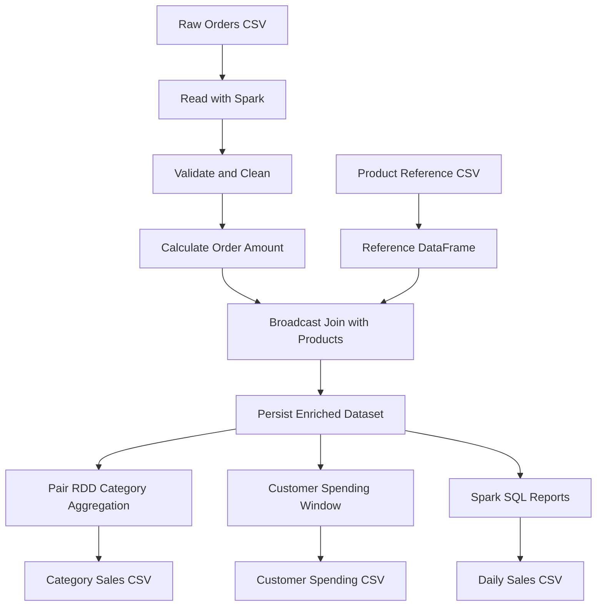

# 🛒 End-to-End E-Commerce Data Engineering Pipeline


## 📌 Project Overview

This project implements an end-to-end batch data engineering pipeline using Scala and Apache Spark. It processes raw e-commerce orders, validates and cleans the data, enriches orders with product reference information, performs distributed aggregation, calculates customer spending windows, and generates business reports.

## 🎯 Objectives

- Build a raw → clean → enrich → aggregate pipeline.
- Use Pair RDD for category-level aggregation.
- Use DataFrames for cleaning, joins, window functions, and SQL reporting.
- Apply broadcast joins and persistence.
- Understand Spark shuffles, stages, and optimization decisions.
- Export reports as CSV datasets.

## 🏗️ Architecture



## 🔄 Pipeline Stages

1. **Raw:** Read order and product CSV files.
2. **Clean:** Parse dates and numeric values, reject invalid quantities and prices, remove duplicate order IDs, and calculate order amounts.
3. **Enrich:** Join orders to product names and categories using a broadcast join.
4. **Aggregate:** Use Pair RDD and Spark SQL to calculate category and daily metrics.
5. **Window:** Calculate cumulative customer spend in order-date sequence.
6. **Output:** Write category sales, customer spending, and daily sales CSV reports.

## 🧾 Input Data

### Orders

`data/raw/orders.csv`

| Column | Meaning |
|---|---|
| `order_id` | Order identifier |
| `customer_id` | Customer identifier |
| `product_id` | Product identifier |
| `quantity` | Units ordered |
| `unit_price` | Price per unit |
| `order_date` | Order date |

### Product Reference

`data/reference/products.csv`

Contains product ID, product name, category, and reference price.

## ⚙️ Technologies

- Scala 2.12.18
- Apache Spark 3.5.3
- Spark Core and Spark SQL
- RDD and Pair RDD
- DataFrames and window functions
- Broadcast joins
- `MEMORY_AND_DISK` persistence
- sbt and Java 17

## 🚀 How to Run

### Prerequisites

Install Java 17 and sbt.

### Compile

```bash
sbt compile
```

### Run

```bash
sbt "runMain ECommercePipeline"
```

The application reads the sample datasets using relative paths from the project root.

## 📊 Results

### Category Sales

| Category | Units Sold | Revenue |
|---|---:|---:|
| Electronics | 8 | 6,800.00 |
| Accessories | 3 | 2,400.00 |
| Stationery | 10 | 2,000.00 |

### Daily Sales

The pipeline reports order counts and revenue by order date.

### Customer Spending

A DataFrame window calculates each customer's cumulative spend ordered by date and order ID.

## ⚡ Spark Execution: Shuffles and Stages

### Pair RDD aggregation

The `reduceByKey` operation combines values locally where possible, then redistributes keys across partitions when required. This key-based redistribution is a shuffle.

### Broadcast join

The product reference dataset is small, so a broadcast join distributes it to executors rather than requiring a full shuffle join of both datasets.

### Window function

The customer window partitions data by customer and orders rows by date. Spark may shuffle data by customer and sort within partitions to execute the window.

### Persistence

`MEMORY_AND_DISK` allows cleaned and enriched datasets to be reused across multiple actions. Persisting a dataset does not eliminate every downstream shuffle.

### Stages

Spark divides execution into stages at shuffle boundaries. Narrow transformations can often be pipelined together; shuffle-dependent transformations typically introduce new stages. The exact plan depends on Spark's optimizer and runtime configuration.

## 📁 Output Structure

```text
output/
├── category_sales/
├── customer_spending/
└── daily_sales/
```

Each output directory contains Spark-generated CSV part files and a success marker.

## 🔮 Future Enhancements

- Add automated data-quality tests.
- Capture rejected records in a quarantine dataset.
- Add explicit schemas instead of relying on inferred CSV types.
- Validate price differences against the product reference price.
- Add incremental processing and deduplication.
- Deploy on a Spark cluster and store data in a data lake.
- Inspect physical plans using `explain("formatted")` and measure Spark UI stages.

## 👨‍💻 Author

**Harshavardhan Ganji**

*Day 29 — Scala and Apache Spark 30-Day Learning Journey*
